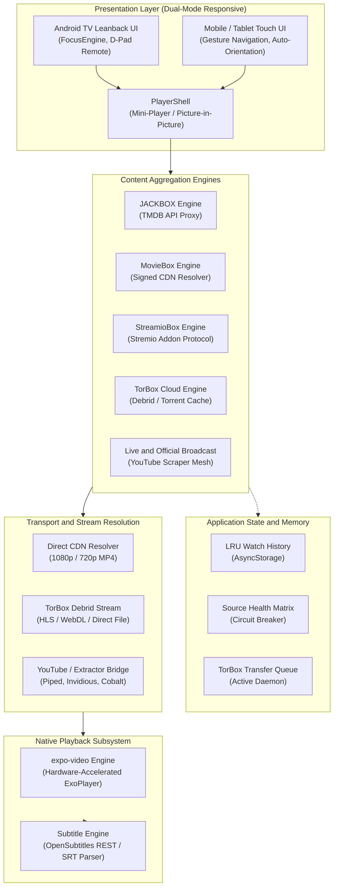
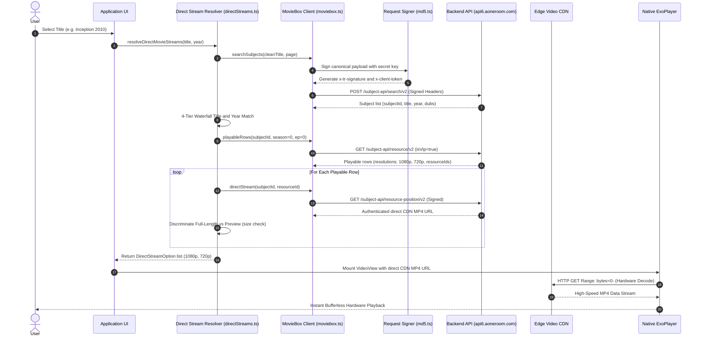
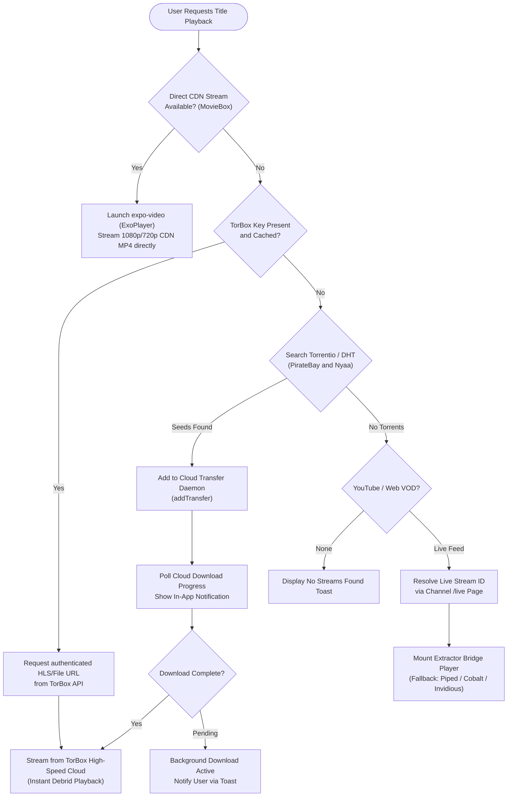
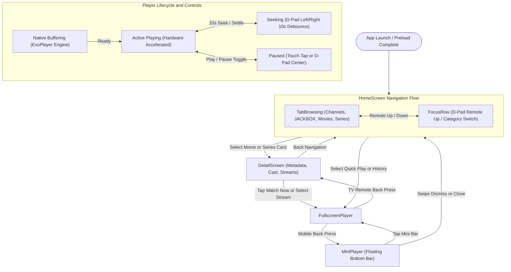

# ForUs — Universal Streaming Platform for Android & Android TV

[](https://developer.android.com/tv)
[-informational?style=flat-square)](https://github.com/react-native-tvos/react-native-tvos)
[-black?style=flat-square)](https://docs.expo.dev/)
[](https://www.typescriptlang.org/)
[-success?style=flat-square)](https://docs.expo.dev/versions/latest/sdk/video/)
[](#)

---

## 1. Executive Summary

**ForUs** is a multi-source media aggregation and playback application engineered from the ground up for cross-form-factor Android deployment. Operating across both **Android TV** (remote-driven 10-foot Leanback interface) and **mobile/tablet touch displays** (adaptive portrait/landscape layouts), the platform eliminates mandatory accounts, authentication walls, and intrusive web layers in favor of a clean, hardware-accelerated native streaming pipeline.

The application synthesizes live broadcast feeds, decentralized metadata registries, high-speed Content Delivery Networks (CDNs), Stremio addon protocols, and cloud debrid services into a singular, cohesive media dashboard.

---

## 2. System Architecture



---

## 3. Core Content Engines

### 3.1. JACKBOX Engine (`src/api/moviedbbox.ts`, `src/screens/JackBoxScreen.tsx`)
The **JACKBOX** engine acts as the primary global discovery layer for international feature films and television series:
* **Metadata Resolution:** Interfaces directly with The Movie Database (TMDB) API via authenticated endpoints, completely bypassing anti-bot Cloudflare challenges that cripple web scrapers.
* **Pagination & Memory Management:** Implements cursor-based infinite scrolling (`loadMore`) with automated batching and memory-efficient list views via `FlatList` subview clipping.
* **Metadata Normalization:** Automatically extracts and links canonical identifiers (`imdb_id`, `tmdb_id`, external IDs, genres, runtimes, and certifications) to prepare titles for direct stream resolution.

### 3.2. MovieBox Cryptographic CDN Engine (`src/api/moviebox.ts`, `src/api/directStreams.ts`)

#### 3.2.1. Multi-Host Pool & Automatic Failover
The client communicates with MovieBox's distributed Backend-for-Frontend (BFF) architecture. To guard against DNS poisoning, regional IP blocking, or server degradation, requests cascade automatically across an active multi-region host pool:
* `https://api6.aoneroom.com` (Primary production gateway)
* `https://api5.aoneroom.com` (Failover cluster A)
* `https://api4.aoneroom.com` (Failover cluster B)
* `https://api6sg.aoneroom.com` (Southeast Asia CDN relay)
* `https://api.inmoviebox.com` (Global ingress backup)

If any host returns an HTTP 5xx error, network timeout (20s budget), or dropped connection, the client seamlessly shifts traffic to the next healthy host without presenting error dialogues to the user.

#### 3.2.2. Synthetic Device Emulation & Session Negotiation
MovieBox's API expects verified requests from its official Android client (`com.community.oneroom`). The client synthesizes and preserves a persistent device identity in `AsyncStorage`:
* **Device Tokens:** Generates a 32-character hexadecimal `deviceId` and randomized Google Advertising ID (`gaid`).
* **Client Fingerprint (`x-client-info`):** Serializes hardware parameters (brand, model, architecture, network type, display dimensions) simulating an Android 13 Cronet environment.
* **Network Masking (`x-forwarded-for`):** Dispatches requests with randomized subnets to prevent centralized IP rate-limiting.
* **Visitor Authentication (`getToken`):** Automatically requests and refreshes ephemeral visitor JWT bearer tokens via `POST /wefeed-mobile-bff/user-api/visitor-login` whenever an HTTP 401 or 407 response occurs.

#### 3.2.3. Cryptographic Request Signing Pipeline
Every outbound HTTP request must be cryptographically signed using deterministic HMAC-MD5 hashing (`src/api/md5.ts`). Requests with invalid or missing signatures are rejected by the server:
1. **Canonicalization:** Formats an RFC-style canonical string combining HTTP method, MIME type, payload byte count, epoch timestamp, MD5 hash of the request body, and alphabetically sorted query parameters:
   $$\text{Canonical} = \text{Method} + "\backslash\text{n}" + \text{ContentType} + "\backslash\text{n}" + \text{ContentLength} + "\backslash\text{n}" + \text{Timestamp} + "\backslash\text{n}" + \text{MD5(Payload)} + "\backslash\text{n}" + \text{CanonicalQuery}$$
2. **Signature Generation:** Hashes the canonical string against the enterprise secret key (`efa891974eecd3148df...`) using pure JavaScript HMAC-MD5 to produce the `x-tr-signature` header:
   $$\text{x-tr-signature} = \text{Timestamp} + "|2|" + \text{HMAC-MD5}_{\text{Base64}}(\text{Secret}, \text{Canonical})$$
3. **Timestamp Token:** Appends `x-client-token` derived from reversed epoch timestamp digits to validate clock synchronization.

#### 3.2.4. End-to-End Movie Ingestion & Stream Resolution
When a user selects any film in the app (e.g. from the JACKBOX catalog, Search, or Watch History), the ingestion pipeline in `src/api/directStreams.ts` resolves playable direct media streams through a multi-stage flow:

1. **Title Normalization:** Cleans the search query by stripping bracketed release tags (e.g., `[Hindi]`, `[CAM]`, `[Dual Audio]`).
2. **Catalog Discovery (`searchSubjects`):** Dispatches a signed query to `/subject-api/search/v2`.
3. **4-Tier Waterfall Title Matching:**
   * **Tier 1 (Exact Match):** Matches normalized title and release year precisely.
   * **Tier 2 (Title Exact):** Matches normalized title regardless of year variance.
   * **Tier 3 (Substring Match):** Resolves titles containing localized suffixes or alternate subtitles.
   * **Tier 4 (Relevance Fallback):** Selects the top search candidate if confidence scores exceed thresholds.
4. **Playable Resource Interrogation (`playableRows`):** Interrogates `/subject-api/resource/v2` with `subjectId` and `isVip=true`. Handles dual-filing idiosyncrasies where standalone feature films may be filed under Season 0/Episode 0 or Season 1/Episode 1.
5. **Full-Length CDN Stream Extraction (`directStream`):** Queries `/subject-api/resource-position/v2` to extract authenticated CDN URLs. A byte-length heuristic (`size > episode.size * 4`) distinguishes true full-length feature files from short marketing teasers/previews.
6. **Subtitles & Multi-Audio Extraction (`captions`):** Ingests multi-language SRT subtitle tracks and audio dubs (e.g. English, Hindi, Malayalam) and synchronizes them directly with the player.
7. **Direct Hardware Playback:** The extracted direct `.mp4` CDN link is loaded into `expo-video` (ExoPlayer). The player issues standard HTTP byte-range requests (`bytes=0-`) directly to edge servers, delivering zero-buffer, hardware-decoded 1080p and 720p playback.

#### MovieBox Request Signing & CDN Stream Sequence



### 3.3. StreamioBox Addon Protocol Engine (`src/api/streamiobox.ts`, `src/screens/StreamioBoxScreen.tsx`)
Implements the decentralized Stremio Addon Specification v3:
* **Catalog Discovery:** Ingests cinematic collections from Cinemeta (`v3-cinemeta.strem.io`), indexing series metadata, season/episode catalogs, and episode thumbnails.
* **P2P Release Aggregation:** Connects to public indexer engines (e.g., Torrentio) to scrape active swarms, reporting resolution (`4K`, `1080p`, `720p`), file container size, audio codecs, and active seed ratios.

### 3.4. TorBox Cloud Debrid Integration (`src/api/torbox.ts`, `src/data/transfers.ts`)
Facilitates seamless cloud torrent and Usenet integration:
* **Cached Cloud Streaming:** Connects to the user's TorBox account via API key stored in secure local storage.
* **Magnet Link Synthesis & Ingestion:** Compiles torrent hashes into standard magnet URIs and dispatches them to TorBox's cloud seedbox infrastructure for instantaneous caching.
* **Real-time Download Daemon:** Continuously inspects transfer lifecycles, notifying the user via foreground toasts (`TransferToast.tsx`) and triggering automatic stream playback when caching finishes.
* **DHT Index Scraping:** Direct multi-provider query pipelines targeting The Pirate Bay and Nyaa to locate niche titles, regional cinema, and anime releases.

### 3.5. Official Live Broadcast & Fallback Mesh (`src/api/sources.ts`, `src/api/extractors.ts`)
Aggregates official Malayalam news channels and entertainment distributors:
* **Official Channel Allowlist:** Strictly restricts search queries and home carousels to verified broadcaster channel IDs (`TRUSTED_CHANNELS` in `src/data/channels.ts`), preventing pirated duplicate re-uploads.
* **Dynamic Live Resolution:** Interrogates YouTube channel `/live` endpoints in real-time to locate ephemeral video IDs for live 24/7 news broadcasts.
* **Fallback Extraction Mesh:** If YouTube restricts iframe embedding on specific networks, traffic automatically cascades across an array of resilient proxies:
  * **Piped API & Frontends**
  * **Invidious Embed Instances**
  * **Cobalt API Direct Stream Extractor**
  * **Consumet Media Extraction Workers**

---

## 4. Playback Architecture & Subsystems

```
┌─────────────────────────────────────────────────────────────┐
│                       PlayerShell                           │
│  ┌───────────────────────┐       ┌────────────────────────┐ │
│  │   StreamPlayerScreen  │  OR   │  MovieboxPlayerScreen  │ │
│  │     (expo-video)      │       │     (Custom D-Pad)     │ │
│  └───────────────────────┘       └────────────────────────┘ │
└──────────────────────────────┬──────────────────────────────┘
                               │
                ┌──────────────┴──────────────┐
                ▼                             ▼
   ExoPlayer Native Core         OpenSubtitles Parser
   - Hardware Decoding (HEVC/AVC) - Real-time REST Querying
   - Surface Lifecycle Management - Synchronized VTT/SRT Overlay
   - Landscape Fullscreen Locks   - Encoding Detection (UTF-8)
```

* **ExoPlayer Hardware Acceleration:** Core video rendering is handled by `expo-video`, wrapping Android's underlying Media3/ExoPlayer native APIs. Supports hardware decoding for AVC/H.264, HEVC/H.265, and VP9.
* **D-Pad TV Navigation Matrix:** Full support for standard Android TV directional inputs:
  * `DPAD_LEFT` / `DPAD_RIGHT`: 10-second relative seeking with debounce throttling (`useRemoteSeek.ts`).
  * `DPAD_CENTER` / `ENTER`: Instant play/pause toggle.
  * `BACK`: Hierarchical collapse — exits fullscreen to mini-player, then closes player, then navigates home.
* **Screen Orientation System (`useFullscreenOrientation.ts`):** On mobile devices, triggering fullscreen invokes native sensor orientation locks (`expo-screen-orientation`), transitioning the display into landscape mode with automated return to portrait upon player dismissal.
* **OpenSubtitles Synchronization (`src/api/opensubtitles.ts`, `src/hooks/useOpenSubtitles.ts`):** Queries OpenSubtitles REST endpoints by IMDb ID, title, and season/episode, fetching and parsing `.srt` files into active subtitle cues.

#### Multi-Tier Stream Resolution Flow



#### Dual-Mode UI Navigation & Player State Machine



---

## 5. Resilience & Fault-Tolerance Patterns

* **Circuit Breaker (`src/api/sourceHealth.ts`):** Tracks availability across all public scrapers and instances. An endpoint that throws HTTP 4xx/5xx or times out is placed on temporary quarantine cooldown with exponential backoff, preventing request stalls.
* **Network Budgeting (`src/api/http.ts`):** Every network call is wrapped by `fetchWithTimeout` (default 8–12 seconds). Prevents hanging TCP connections from blocking the UI thread on high-latency mobile networks.
* **State Preservation & Fast Resume:** 
  * Home tabs and scroll offsets maintain state across screen transitions.
  * Dedicated memory threshold (`RESTORE_WINDOW_MS`) restores previous scroll coordinates when returning from video playback.
  * Stale data is gracefully revalidated after `STALE_AFTER_MS` (10 minutes) without jarring layout shifts.

#### Adaptive Circuit Breaker State Transition


---

## 6. Directory Layout

```
MytvstreamApp/
├── App.tsx                     # Root controller, state coordinator, back handler
├── app.json                    # Expo config & Android TV Leanback declarations
├── build-apk.sh                # Automated CI/CD release build & device deployment script
├── package.json                # Dependency specifications & overrides
├── plugins/                    # Expo Config Plugins (Custom signing, TV configs)
└── src/
    ├── api/                    # Core communication & extraction engines
    │   ├── directStreams.ts    # MovieBox CDN direct MP4 stream resolver
    │   ├── extractors.ts       # Cobalt, Piped, Invidious & Consumet extractors
    │   ├── http.ts             # fetchWithTimeout networking budget utility
    │   ├── md5.ts              # Native-free pure JS MD5 cryptographic hashing
    │   ├── moviebox.ts         # Reverse-engineered MovieBox API client
    │   ├── moviedbbox.ts       # TMDB API client & JACKBOX engine
    │   ├── opensubtitles.ts    # Subtitle discovery and SRT parser
    │   ├── sourceHealth.ts     # Scraper health tracking & circuit breaker
    │   ├── sources.ts          # Multi-source playback fallback dispatcher
    │   ├── streamiobox.ts      # Stremio Addon Protocol v3 client
    │   ├── torbox.ts           # TorBox API client & stream tokenizer
    │   └── torrents.ts         # Torrentio, PirateBay & Nyaa scrapers
    ├── components/             # Reusable UI primitives (FocusCard, Shimmer, etc.)
    │   ├── FocusCard.tsx       # TV remote focus-aware card wrapper
    │   ├── HeroCarousel.tsx    # Responsive featured content carousel
    │   ├── PlayerShell.tsx     # Floating mini-player container
    │   └── ReleaseList.tsx     # Stream & torrent release listing view
    ├── data/                   # Static models, registries & local databases
    │   ├── channels.ts         # Verified channel allowlist & category indices
    │   ├── history.ts          # LRU playback history persistence
    │   └── transfers.ts        # TorBox background cloud transfer daemon
    ├── hooks/                  # Custom React hooks (D-pad remote, orientation, events)
    ├── screens/                # Top-level application views
    │   ├── HomeScreen.tsx      # Main tabbed dashboard (TV & Mobile)
    │   ├── JackBoxScreen.tsx   # JACKBOX TMDB discovery & search view
    │   ├── MovieboxScreen.tsx  # MovieBox catalog & row explorer
    │   ├── MovieScreen.tsx     # Movie details, direct streams & releases
    │   ├── StreamPlayerScreen.tsx # Native ExoPlayer video playback interface
    │   └── TorboxSetupScreen.tsx  # API key registration & account status
    └── theme.ts                # Design tokens, color system, and TV scale helpers
```

---

## 7. Build Toolchain & Deployment

### 7.1. Prerequisites
* **Node.js:** v20.x or higher
* **Java Development Kit:** JDK 21 (required by Android Gradle Plugin 8.x/Gradle 9.x)
* **Android SDK:** Platforms 34–36, Build-Tools 36.0.0
* **Android NDK:** 27.1.12297006

### 7.2. Environment Configuration
Set the following paths in your shell profile:

```bash
export JAVA_HOME="$HOME/Android/jdk-21"
export ANDROID_HOME="$HOME/Android/Sdk"
export PATH="$JAVA_HOME/bin:$ANDROID_HOME/platform-tools:$PATH"
```

### 7.3. Compilation Commands

```bash
# Install dependencies
npm install

# Perform clean Continuous Native Generation (CNG) prebuild
npx expo prebuild --platform android --clean

# Local development build and run
npx expo run:android

# Automated release build, installation, and storage push
./build-apk.sh --install --push
```

### 7.4. Release Hardening & Optimization
* **R8 Obfuscation & Tree-Shaking:** Automated R8 minification is enabled for all release variants (`android.enableMinifyInReleaseBuilds=true`), optimizing dex sizes and stripping unused symbols.
* **ProGuard Mapping:** `build-apk.sh` captures and preserves `mapping.txt` alongside each compiled APK to facilitate symbol de-obfuscation in production crash analytics.
* **Package Verification:** Automated updates check package integrity using SHA-256 digests published in the version manifest (`version.json`).

---

## 8. TV Remote Reference

| Key / Action | Home Dashboard | Video Playback |
| :--- | :--- | :--- |
| **D-Pad Up / Down** | Vertical navigation across content rows | Display / hide on-screen playback controls |
| **D-Pad Left / Right** | Horizontal carousel / grid navigation | Relative 10-second seek backward / forward |
| **Select / Enter** | Open selected title / trigger action | Toggle Play / Pause |
| **Back Button** | Focus top tab navigation ➔ Exit app | Exit fullscreen ➔ Return to parent view |

---

## 9. License & Usage Notice

This software is developed strictly for educational and personal research into cross-platform UI architectures, resilient media transport protocols, and hardware-accelerated video rendering on Android. All video streams originate from public third-party endpoints, decentralized indexes, and official distributor uploads.

### 9.1. P2P & Torrent Source Risk Notice

> [!WARNING]
> **Torrent & Peer-to-Peer (P2P) Streaming Involves Privacy and Legal Risks:**
>
> * **Public IP Exposure in Swarms:** Standard BitTorrent and DHT mechanisms expose your device's public IP address to all peers and seeders participating in the active swarm. When not proxied through an encrypted cloud debrid service (such as TorBox) or a secure VPN, your network identity is publicly discoverable by third parties and Internet Service Providers (ISPs).
> * **Copyrighted Material & Jurisdiction Compliance:** Public torrent indexers (such as Torrentio, The Pirate Bay, and Nyaa) crawl decentralized swarms containing user-uploaded content. Streaming, caching, or downloading copyrighted media without legitimate rights or authorization may violate intellectual property laws in your jurisdiction.
> * **Cloud Debrid Recommended for Privacy:** When configured with a personal TorBox API key, torrent links are cached and downloaded remotely to TorBox cloud infrastructure and streamed to your player via secure, point-to-point encrypted HTTPS/HLS channels, eliminating direct P2P swarm exposure on your local network.
> * **No Media Hosting:** The developers and maintainers of this repository do not host, store, cache, upload, or distribute any media files, video streams, or torrent trackers. This application operates exclusively as a client-side user interface and indexing parser.
>
> Users assume full legal and operational responsibility for verifying copyright licenses and complying with local telecommunications and digital media regulations when querying torrent sources.
