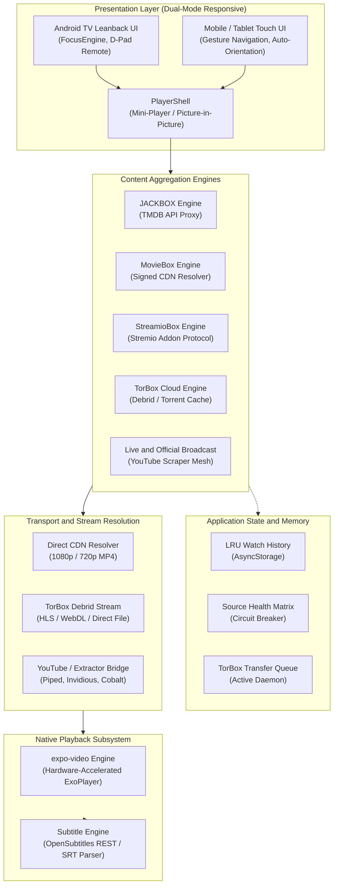
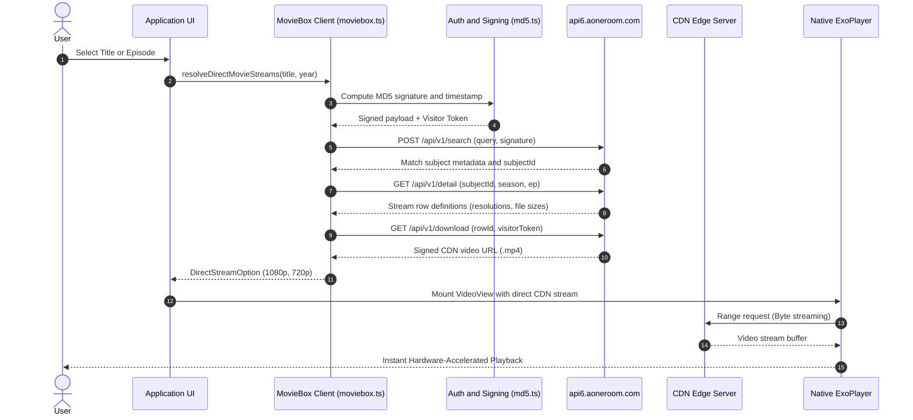
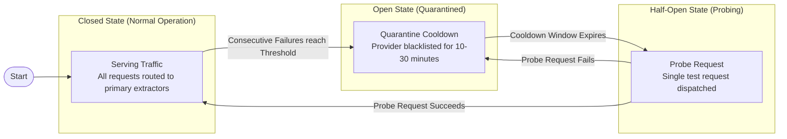

# ForUs — Universal Streaming Platform for Android & Android TV

[](https://developer.android.com/tv)
[-informational?style=flat-square)](https://github.com/react-native-tvos/react-native-tvos)
[-black?style=flat-square)](https://docs.expo.dev/)
[](https://www.typescriptlang.org/)
[-success?style=flat-square)](https://docs.expo.dev/versions/latest/sdk/video/)
[](#)

---

## 1. Executive Summary

**ForUs** is a multi-source media aggregation and playback application engineered from the ground up for cross-form-factor Android deployment. Operating across both **Android TV** (remote-driven 10-foot Leanback interface) and **mobile/tablet touch displays** (adaptive portrait/landscape layouts), the platform eliminates mandatory accounts, authentication walls, and intrusive web layers in favor of a clean, hardware-accelerated native streaming pipeline.

The application synthesizes live broadcast feeds, decentralized metadata registries, high-speed Content Delivery Networks (CDNs), Stremio addon protocols, and cloud debrid services into a singular, cohesive media dashboard.

---

## 2. System Architecture



---

## 3. Core Content Engines

### 3.1. JACKBOX Engine (`src/api/moviedbbox.ts`, `src/screens/JackBoxScreen.tsx`)
The **JACKBOX** engine acts as the primary global discovery layer for international feature films and television series:
* **Metadata Resolution:** Interfaces directly with The Movie Database (TMDB) API via authenticated endpoints, completely bypassing anti-bot Cloudflare challenges that cripple web scrapers.
* **Pagination & Memory Management:** Implements cursor-based infinite scrolling (`loadMore`) with automated batching and memory-efficient list views via `FlatList` subview clipping.
* **Metadata Normalization:** Automatically extracts and links canonical identifiers (`imdb_id`, `tmdb_id`, external IDs, genres, runtimes, and certifications) to prepare titles for direct stream resolution.

### 3.2. MovieBox Cryptographic CDN Engine (`src/api/moviebox.ts`, `src/api/directStreams.ts`)
A zero-login reverse-engineered client for the MovieBox enterprise content delivery network:
* **Cryptographic Request Signing:** Emulates native client request signing using deterministic MD5 HMAC hashing (`src/api/md5.ts`) with visitor session negotiation on `api6.aoneroom.com`.
* **Direct MP4 Extraction:** Interrogates subject hierarchies (`searchSubjects` ➔ `playableRows` ➔ `directStream`) to resolve direct, clean, full-length **1080p, 720p, and 480p CDN MP4 video streams**.
* **Zero-Buffer Playback:** Streams raw `.mp4` URLs directly into the native video player without web wrappers, iframe sandboxes, or advertisement injections.

#### MovieBox Request Signing & CDN Stream Sequence



### 3.3. StreamioBox Addon Protocol Engine (`src/api/streamiobox.ts`, `src/screens/StreamioBoxScreen.tsx`)
Implements the decentralized Stremio Addon Specification v3:
* **Catalog Discovery:** Ingests cinematic collections from Cinemeta (`v3-cinemeta.strem.io`), indexing series metadata, season/episode catalogs, and episode thumbnails.
* **P2P Release Aggregation:** Connects to public indexer engines (e.g., Torrentio) to scrape active swarms, reporting resolution (`4K`, `1080p`, `720p`), file container size, audio codecs, and active seed ratios.

### 3.4. TorBox Cloud Debrid Integration (`src/api/torbox.ts`, `src/data/transfers.ts`)
Facilitates seamless cloud torrent and Usenet integration:
* **Cached Cloud Streaming:** Connects to the user's TorBox account via API key stored in secure local storage.
* **Magnet Link Synthesis & Ingestion:** Compiles torrent hashes into standard magnet URIs and dispatches them to TorBox's cloud seedbox infrastructure for instantaneous caching.
* **Real-time Download Daemon:** Continuously inspects transfer lifecycles, notifying the user via foreground toasts (`TransferToast.tsx`) and triggering automatic stream playback when caching finishes.
* **DHT Index Scraping:** Direct multi-provider query pipelines targeting The Pirate Bay and Nyaa to locate niche titles, regional cinema, and anime releases.

### 3.5. Official Live Broadcast & Fallback Mesh (`src/api/sources.ts`, `src/api/extractors.ts`)
Aggregates official Malayalam news channels and entertainment distributors:
* **Official Channel Allowlist:** Strictly restricts search queries and home carousels to verified broadcaster channel IDs (`TRUSTED_CHANNELS` in `src/data/channels.ts`), preventing pirated duplicate re-uploads.
* **Dynamic Live Resolution:** Interrogates YouTube channel `/live` endpoints in real-time to locate ephemeral video IDs for live 24/7 news broadcasts.
* **Fallback Extraction Mesh:** If YouTube restricts iframe embedding on specific networks, traffic automatically cascades across an array of resilient proxies:
  * **Piped API & Frontends**
  * **Invidious Embed Instances**
  * **Cobalt API Direct Stream Extractor**
  * **Consumet Media Extraction Workers**

---

## 4. Playback Architecture & Subsystems

```
┌─────────────────────────────────────────────────────────────┐
│                       PlayerShell                           │
│  ┌───────────────────────┐       ┌────────────────────────┐ │
│  │   StreamPlayerScreen  │  OR   │  MovieboxPlayerScreen  │ │
│  │     (expo-video)      │       │     (Custom D-Pad)     │ │
│  └───────────────────────┘       └────────────────────────┘ │
└──────────────────────────────┬──────────────────────────────┘
                               │
                ┌──────────────┴──────────────┐
                ▼                             ▼
   ExoPlayer Native Core         OpenSubtitles Parser
   - Hardware Decoding (HEVC/AVC) - Real-time REST Querying
   - Surface Lifecycle Management - Synchronized VTT/SRT Overlay
   - Landscape Fullscreen Locks   - Encoding Detection (UTF-8)
```

* **ExoPlayer Hardware Acceleration:** Core video rendering is handled by `expo-video`, wrapping Android's underlying Media3/ExoPlayer native APIs. Supports hardware decoding for AVC/H.264, HEVC/H.265, and VP9.
* **D-Pad TV Navigation Matrix:** Full support for standard Android TV directional inputs:
  * `DPAD_LEFT` / `DPAD_RIGHT`: 10-second relative seeking with debounce throttling (`useRemoteSeek.ts`).
  * `DPAD_CENTER` / `ENTER`: Instant play/pause toggle.
  * `BACK`: Hierarchical collapse — exits fullscreen to mini-player, then closes player, then navigates home.
* **Screen Orientation System (`useFullscreenOrientation.ts`):** On mobile devices, triggering fullscreen invokes native sensor orientation locks (`expo-screen-orientation`), transitioning the display into landscape mode with automated return to portrait upon player dismissal.
* **OpenSubtitles Synchronization (`src/api/opensubtitles.ts`, `src/hooks/useOpenSubtitles.ts`):** Queries OpenSubtitles REST endpoints by IMDb ID, title, and season/episode, fetching and parsing `.srt` files into active subtitle cues.

#### Multi-Tier Stream Resolution Flow


#### Dual-Mode UI Navigation & Player State Machine


---

## 5. Resilience & Fault-Tolerance Patterns

* **Circuit Breaker (`src/api/sourceHealth.ts`):** Tracks availability across all public scrapers and instances. An endpoint that throws HTTP 4xx/5xx or times out is placed on temporary quarantine cooldown with exponential backoff, preventing request stalls.
* **Network Budgeting (`src/api/http.ts`):** Every network call is wrapped by `fetchWithTimeout` (default 8–12 seconds). Prevents hanging TCP connections from blocking the UI thread on high-latency mobile networks.
* **State Preservation & Fast Resume:** 
  * Home tabs and scroll offsets maintain state across screen transitions.
  * Dedicated memory threshold (`RESTORE_WINDOW_MS`) restores previous scroll coordinates when returning from video playback.
  * Stale data is gracefully revalidated after `STALE_AFTER_MS` (10 minutes) without jarring layout shifts.

#### Adaptive Circuit Breaker State Transition



---

## 6. Directory Layout

```
MytvstreamApp/
├── App.tsx                     # Root controller, state coordinator, back handler
├── app.json                    # Expo config & Android TV Leanback declarations
├── build-apk.sh                # Automated CI/CD release build & device deployment script
├── package.json                # Dependency specifications & overrides
├── plugins/                    # Expo Config Plugins (Custom signing, TV configs)
└── src/
    ├── api/                    # Core communication & extraction engines
    │   ├── directStreams.ts    # MovieBox CDN direct MP4 stream resolver
    │   ├── extractors.ts       # Cobalt, Piped, Invidious & Consumet extractors
    │   ├── http.ts             # fetchWithTimeout networking budget utility
    │   ├── md5.ts              # Native-free pure JS MD5 cryptographic hashing
    │   ├── moviebox.ts         # Reverse-engineered MovieBox API client
    │   ├── moviedbbox.ts       # TMDB API client & JACKBOX engine
    │   ├── opensubtitles.ts    # Subtitle discovery and SRT parser
    │   ├── sourceHealth.ts     # Scraper health tracking & circuit breaker
    │   ├── sources.ts          # Multi-source playback fallback dispatcher
    │   ├── streamiobox.ts      # Stremio Addon Protocol v3 client
    │   ├── torbox.ts           # TorBox API client & stream tokenizer
    │   └── torrents.ts         # Torrentio, PirateBay & Nyaa scrapers
    ├── components/             # Reusable UI primitives (FocusCard, Shimmer, etc.)
    │   ├── FocusCard.tsx       # TV remote focus-aware card wrapper
    │   ├── HeroCarousel.tsx    # Responsive featured content carousel
    │   ├── PlayerShell.tsx     # Floating mini-player container
    │   └── ReleaseList.tsx     # Stream & torrent release listing view
    ├── data/                   # Static models, registries & local databases
    │   ├── channels.ts         # Verified channel allowlist & category indices
    │   ├── history.ts          # LRU playback history persistence
    │   └── transfers.ts        # TorBox background cloud transfer daemon
    ├── hooks/                  # Custom React hooks (D-pad remote, orientation, events)
    ├── screens/                # Top-level application views
    │   ├── HomeScreen.tsx      # Main tabbed dashboard (TV & Mobile)
    │   ├── JackBoxScreen.tsx   # JACKBOX TMDB discovery & search view
    │   ├── MovieboxScreen.tsx  # MovieBox catalog & row explorer
    │   ├── MovieScreen.tsx     # Movie details, direct streams & releases
    │   ├── StreamPlayerScreen.tsx # Native ExoPlayer video playback interface
    │   └── TorboxSetupScreen.tsx  # API key registration & account status
    └── theme.ts                # Design tokens, color system, and TV scale helpers
```

---

## 7. Build Toolchain & Deployment

### 7.1. Prerequisites
* **Node.js:** v20.x or higher
* **Java Development Kit:** JDK 21 (required by Android Gradle Plugin 8.x/Gradle 9.x)
* **Android SDK:** Platforms 34–36, Build-Tools 36.0.0
* **Android NDK:** 27.1.12297006

### 7.2. Environment Configuration
Set the following paths in your shell profile:

```bash
export JAVA_HOME="$HOME/Android/jdk-21"
export ANDROID_HOME="$HOME/Android/Sdk"
export PATH="$JAVA_HOME/bin:$ANDROID_HOME/platform-tools:$PATH"
```

### 7.3. Compilation Commands

```bash
# Install dependencies
npm install

# Perform clean Continuous Native Generation (CNG) prebuild
npx expo prebuild --platform android --clean

# Local development build and run
npx expo run:android

# Automated release build, installation, and storage push
./build-apk.sh --install --push
```

### 7.4. Release Hardening & Optimization
* **R8 Obfuscation & Tree-Shaking:** Automated R8 minification is enabled for all release variants (`android.enableMinifyInReleaseBuilds=true`), optimizing dex sizes and stripping unused symbols.
* **ProGuard Mapping:** `build-apk.sh` captures and preserves `mapping.txt` alongside each compiled APK to facilitate symbol de-obfuscation in production crash analytics.
* **Package Verification:** Automated updates check package integrity using SHA-256 digests published in the version manifest (`version.json`).

---

## 8. TV Remote Reference

| Key / Action | Home Dashboard | Video Playback |
| :--- | :--- | :--- |
| **D-Pad Up / Down** | Vertical navigation across content rows | Display / hide on-screen playback controls |
| **D-Pad Left / Right** | Horizontal carousel / grid navigation | Relative 10-second seek backward / forward |
| **Select / Enter** | Open selected title / trigger action | Toggle Play / Pause |
| **Back Button** | Focus top tab navigation ➔ Exit app | Exit fullscreen ➔ Return to parent view |

---

## 9. License & Usage Notice

This software is developed strictly for educational and personal research into cross-platform UI architectures, resilient media transport protocols, and hardware-accelerated video rendering on Android. All video streams originate from public third-party endpoints, decentralized indexes, and official distributor uploads.
